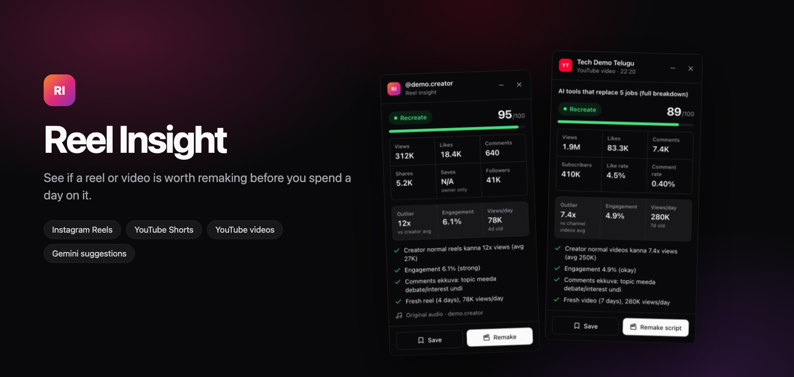
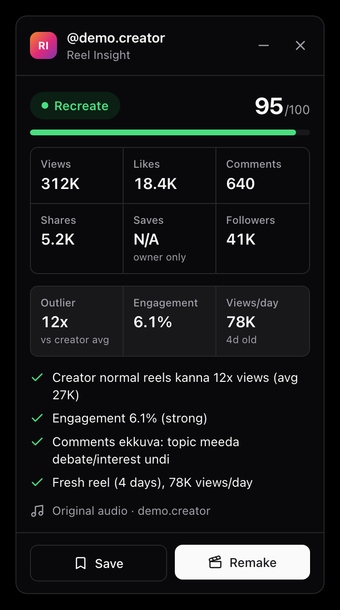
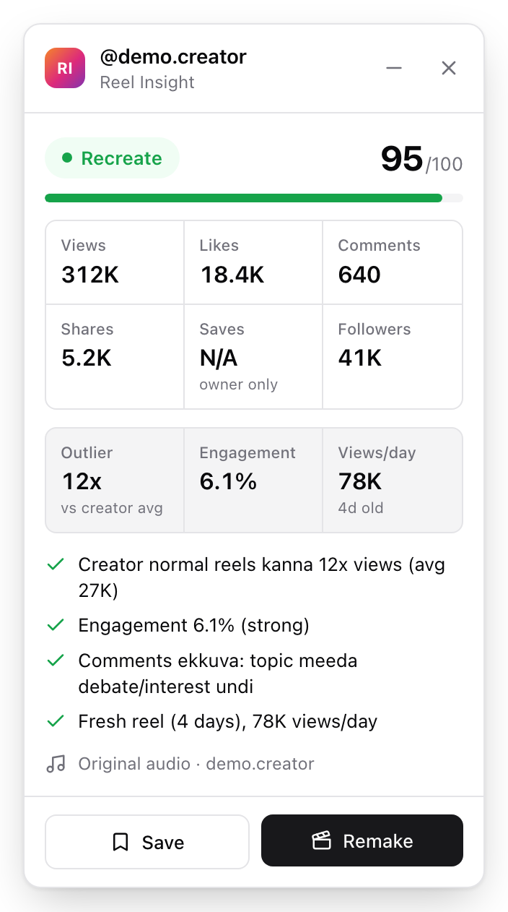
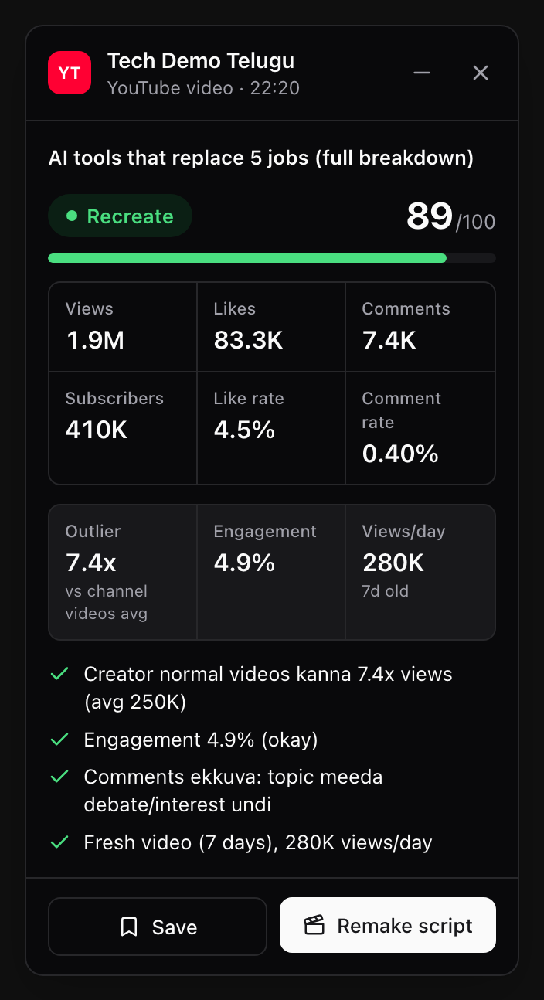
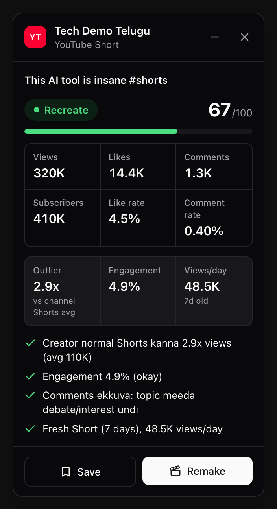
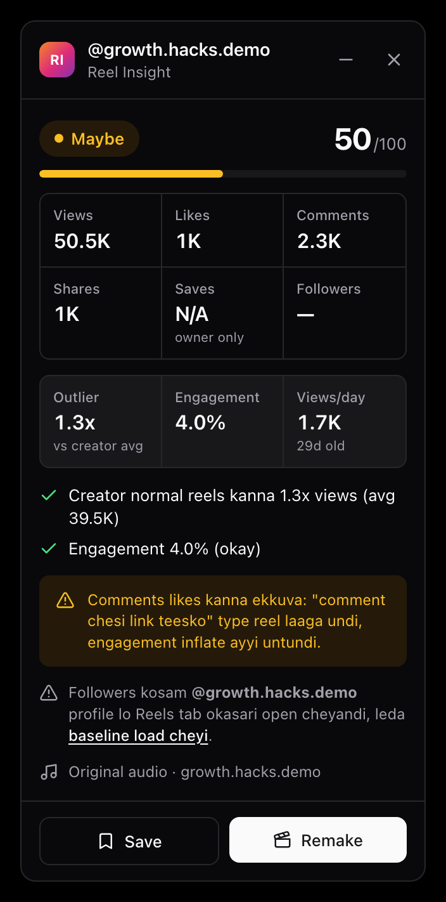
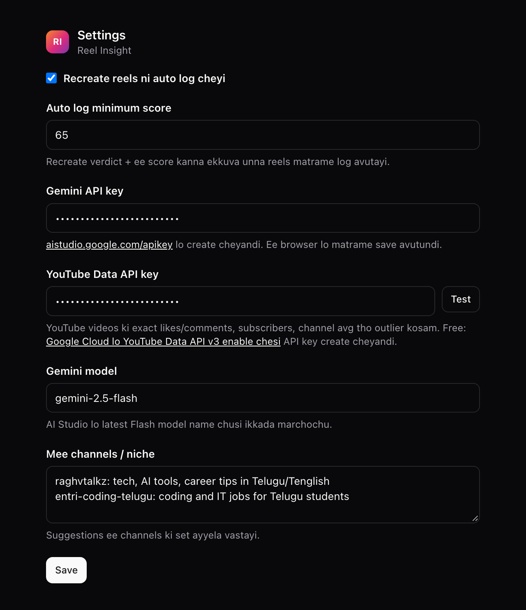
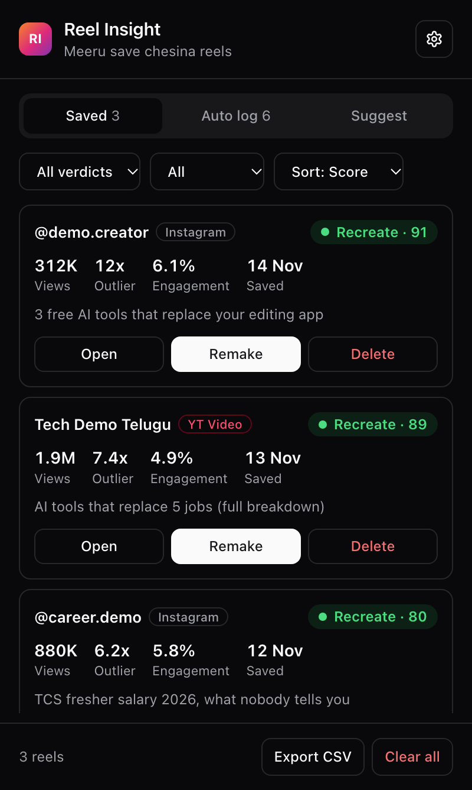
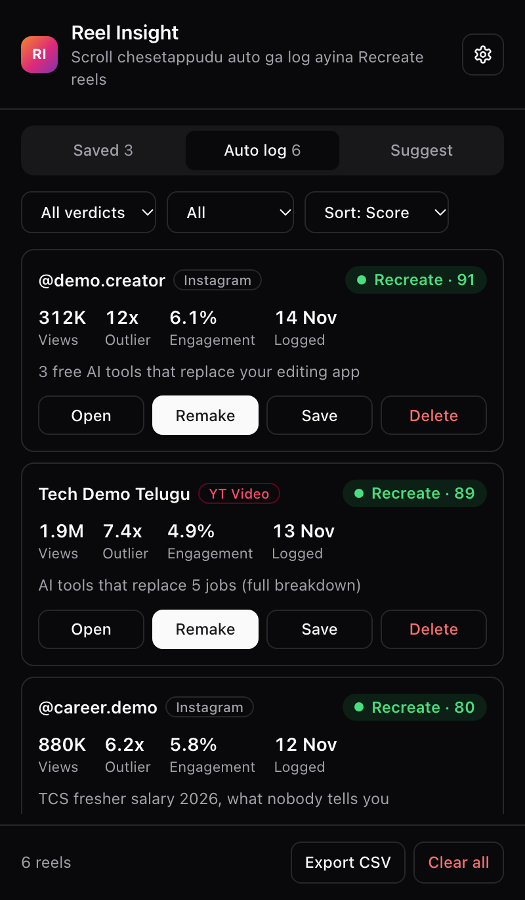
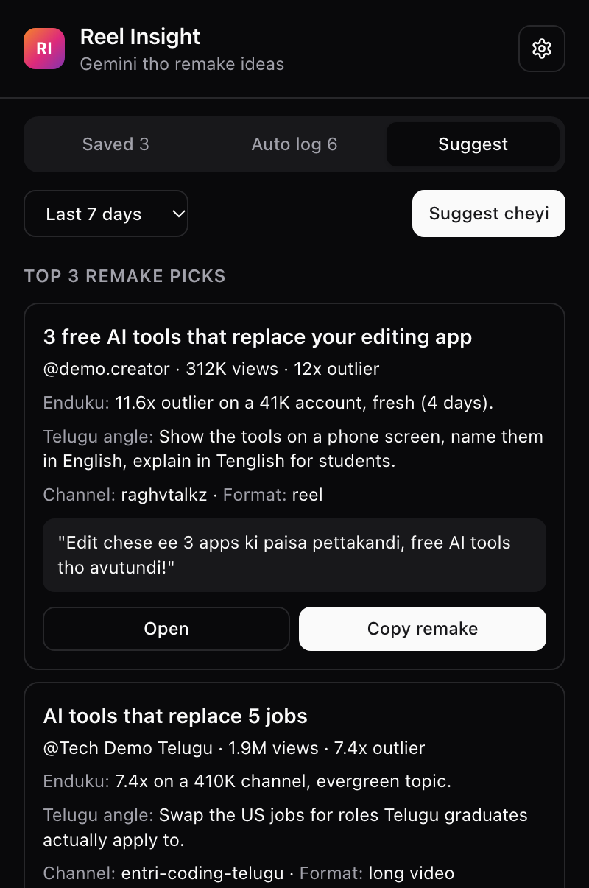

<div align="center">



# 🎬 Reel Insight

**Open a reel or video. Know in two seconds if it is worth remaking.**

A Chrome extension that adds a small card to **Instagram Reels**, **YouTube Shorts** and **YouTube videos**. It shows the stats, scores the post against what that creator normally gets, and says **Recreate, Maybe or Skip**. Built for Telugu and Tenglish creators who remake what is already working.

Built by **Raghav** · Chrome (Manifest V3) · Vanilla JS, no build step · Gemini for suggestions

</div>

## ✨ Features

| | |
|---|---|
| **📊 Stats card** | Views, likes, comments, shares and followers (or subscribers) on the page you are already watching. Saves are only visible to the owner, so the card says `N/A` instead of guessing. |
| **🎯 Outlier score** | The number that matters. This post's views against **that creator's own median**, not against the whole platform. A 12x outlier on a 41K account beats 1M views on a 5M account. |
| **✅ Recreate / Maybe / Skip** | A 0 to 100 score from outlier, engagement, comment depth and freshness. Strong engagement alone can never earn a Recreate. |
| **🤖 Auto log** | Reels that score Recreate while you scroll are logged for you. No extra requests, so no account risk. |
| **⭐ Swipe file** | Save any post in one click. Filter by verdict and platform, sort by score or outlier, export to CSV. |
| **🎬 Remake button** | Copies `/reel-remake <url>` for Reels and Shorts, or a `/yt-script` prompt for long videos, ready to paste into Claude Code. |
| **💡 Suggest (Gemini)** | Sends your saved and logged posts to Gemini and gets back the **top 3 to remake**, the Telugu angle, which of your channels fits, and an opening hook in Tenglish. |
| **🚩 Comment-bait check** | "Comment AI for the link" posts have more comments than likes. The card flags them so inflated engagement does not fool you. |
| **🌗 Light / dark** | Follows the page theme. Drag the card anywhere and it remembers the spot. |

## 📸 Screenshots

> Screenshots use fictional accounts and made-up numbers.

| Instagram Reel: Recreate | Light mode |
|---|---|
|  |  |

| YouTube long video | YouTube Short |
|---|---|
|  |  |

| Comment-bait warning | Settings |
|---|---|
|  |  |

| Swipe file | Auto log | Suggest |
|---|---|---|
|  |  |  |

## 🚀 Quick start

1. Download or clone this repo.
2. Open `chrome://extensions` and switch on **Developer mode**.
3. Click **Load unpacked** and pick this folder.
4. Pin the extension, then reload any open Instagram or YouTube tab.
5. Open a reel or a video. The card appears on the right.

Optional keys (click the ⚙ in the popup):

| Key | What it unlocks | Cost |
|---|---|---|
| **YouTube Data API key** | Exact likes and comments, subscriber count, and the channel average for outlier scores on YouTube. Enable *YouTube Data API v3* in Google Cloud and create a key. A **Test** button checks it. | Free quota |
| **Gemini API key** | The **Suggest** tab. Get one at [aistudio.google.com/apikey](https://aistudio.google.com/apikey). Check AI Studio for the current Flash model name and paste it in Settings if the default is out of date. | Free tier |

Without the YouTube key the card still works from what the page shows, and the outlier falls back to views against subscribers.

## 🧮 How the verdict works

| Signal | Points | What it checks |
|---|---|---|
| **Outlier** | up to 50 | Views against the creator's median (needs 4+ of their other posts), or against followers when there is no baseline |
| **Engagement** | up to 25 | (likes + comments) ÷ views |
| **Conversation** | up to 10 | Comments ÷ likes |
| **Freshness** | up to 15 | Posts under two weeks old score highest |

**65 and up** is Recreate, **45 to 64** is Maybe, below that is Skip. Then a few guards pull a Recreate back to Maybe:

- Fewer than 10K views.
- No real outlier (under 2x the creator's median, or under 1.5x followers).
- No baseline at all, so the outlier is unknown.

On YouTube, Shorts are compared with that channel's Shorts and long videos with its long videos. Videos under three days old are left out of the baseline because their views are still climbing.

## 🔒 Privacy and safety

- Everything stays in `chrome.storage.local`. There is no server and no analytics.
- Instagram stats are read from the data the page already loaded for the posts you open. The extension never likes, follows, comments or posts.
- It makes **no automatic Instagram API calls**, because Instagram rate limits them. Loading a creator baseline is one click on the card, or just open their Reels tab once.
- YouTube numbers come from the official YouTube Data API with your own key.
- Gemini is only called when you press **Suggest**, and only with the stats and captions of your saved posts.
- Do not use it for bulk scraping. Browse normally and let it read what you open.

## ⚠️ Known limits

- Instagram changes its internal data format now and then. If a card says *Stats load avvaledu*, the field names in `src/inject.js` need an update.
- Shares are public on only some Instagram reels. Saves are never public. YouTube has no public shares.
- Photo posts have no views, so they get no verdict.
- Card text is Tenglish (Telugu in English letters), on purpose.
- Instagram was tested on real accounts. YouTube support is new, so open an issue if a number looks off.

## 🗺️ Roadmap

- Find viral posts in a niche. This needs a cloud scraper, not the extension, so it stays outside to protect your account. The `ig-viral` skill covers it for now.
- Facebook Reels.
- Import your own Instagram and YouTube analytics, so the baseline is your audience as well as the creator's.
- Track the reels you remade and learn which formats work for your channel.

## 📁 What is in here

```
manifest.json         Manifest V3, Instagram + YouTube + two API hosts
src/inject.js         Instagram: reads the page's own data (page world)
src/content.js        Instagram card, auto log, swipe file
src/yt-inject.js      YouTube: reads the player response (page world)
src/yt.js             YouTube card (Shorts + long videos)
src/background.js     YouTube Data API calls and channel baseline cache
src/score.js          The scoring and verdict logic
src/ui.js             Shared card styles and icons
popup/                Swipe file, auto log and Suggest tabs
options/              Settings (keys, threshold, your channels)
docs/screenshots/     The images above
```

The card design follows the [shadcn/ui](https://ui.shadcn.com/) look (zinc tokens), written as plain CSS so there is nothing to build. Icons are from [Lucide](https://lucide.dev/).

## ❓ Questions

Open an issue, or find me as **raghvtalkz**.
